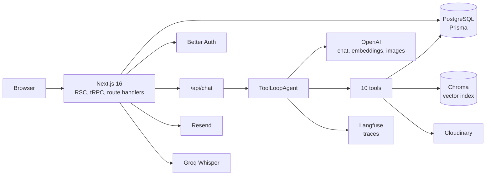

# Mantel Azul

Mantel Azul is a recipe app in English, Spanish and German. It keeps your recipes, organizes them into cookbooks, plans the week with the people you live with, and hands the tedious parts to a cooking assistant: transcribing a handwritten card from a photo, creating the recipe in three languages, generating a cover image, or filling the calendar.

Live at [mantelazul.com](https://mantelazul.com).

## What it does

| Area | Details |
| --- | --- |
| AI Assistant | A chat that finds recipes, reads food photos, creates and edits recipes, plans meals, generates images and takes voice dictation. |
| Recipes | Create, edit, like and browse recipes with categories, tags, difficulty, times, nutrition per serving, cover images and step photos. |
| Search | Semantic search across every published recipe and your own drafts, in the language you ask. |
| Cookbooks | Personal collections of recipes. |
| Meal planner | A week calendar where each meal is private or shared with your household. |
| Households | Invite people by email, share the calendar, and keep meals with the household when someone leaves. |
| Accounts | Email/password and Google sign-in, mandatory email verification, password reset and account deletion. |
| Languages | English, Spanish and German, including automatic recipe translation and localized legal pages. |

## Architecture

Next.js 16 renders the pages on the server and handles mutations through tRPC. PostgreSQL is the source of truth and Prisma owns the schema. The chat runs in a streaming route handler and drives an AI SDK `ToolLoopAgent` with ten tools. Chroma holds the recipe vector index, Cloudinary stores images, Resend sends account email, and Langfuse collects traces through OpenTelemetry.



The UI is built with Tailwind CSS 4, Base UI and shadcn/ui. `next-intl` handles routing and messages for the three locales.

## The AI Assistant

One agent handles the conversation. Each request rebuilds its instructions with the current date, the user's household, the images attached or generated in the conversation, and a summary of earlier turns. The agent can take up to fifteen steps per message, which is enough to search, read a recipe, generate an image and write a meal plan without letting a single turn run away.

### Tools

| Tool | Purpose |
| --- | --- |
| `searchRecipes` | Semantic search with filters for scope and total time. |
| `getOneRecipe` | Read a full recipe before answering questions or changing it. |
| `getFavouriteRecipes` | List the recipes the user liked. |
| `getTags` | Reuse existing tags when creating or updating a recipe. |
| `getMealPlan` | Read the calendar before planning. |
| `createRecipe` | Save a new recipe, with a cover image and all three translations. |
| `updateRecipe` | Change a recipe after reading its current state. |
| `deleteRecipe` | Remove a recipe. |
| `planMeals` | Write a batch of meals to the calendar. |
| `generateRecipeImage` | Generate and upload a food photograph. |

`createRecipe`, `updateRecipe`, `deleteRecipe` and `planMeals` require explicit user approval. The approval is matched against the stored tool call, so a client cannot invent one or approve a call from another conversation.

### Conversation memory

The prompt has a conservative 64k-token budget. When a conversation reaches it, older turns are folded into a stored summary in Postgres and only the most recent turns are sent verbatim. The window never starts in the middle of a turn, and it keeps a pending approval together with the user message that led to it. If summarization fails, the recent window is still used: losing old context is better than failing the message.

### Guardrails

- A small classifier checks each user message before the agent runs. Off-topic, unsafe and prompt-injection messages are refused before they reach a tool.
- The system prompt separates instructions from data. Recipes, tags, meal notes, tool results and the conversation summary are treated as untrusted content.
- Tool inputs are sanitized and bounded before they reach the database.
- A second model checks that a recipe is real food before it is saved, and refuses non-food items, weapons, drugs, cosmetics and household cleaners.
- Generated images pass through a vision check. Anything that is not food is discarded before the URL reaches the model or the user.
- Chat writes are scoped to the session owner. Message IDs are generated on the server, and attached files must be Cloudinary URLs owned by the app.
- Chat, image generation and transcription have per-user limits stored in Postgres, because serverless instances do not share memory.

## Retrieval

Each recipe is embedded as a labeled natural-language document built from its title, description, category, difficulty, servings, total time, tags, ingredients, steps and nutrition. The document is always built from the canonical locale, so a query in Spanish can still match an English recipe. A SHA-256 hash of the document avoids re-embedding a recipe that has not changed.

Chroma stores the embedding, the three fields the search filters on (author, publish state and total time), and a content hash. The recipe itself is hydrated from Postgres after the search, so the vector store never becomes a second source of truth.

Search uses two similarity floors. Open requests such as "ideas for dinner" use a low floor because a loose match is still useful. When the user names a dish, the floor is 0.45, measured against the live index: real matches scored 0.55 to 0.70, while the closest neighbors of a dish the app does not have stayed at or below 0.40. That gap is what lets the assistant say "we don't have that" instead of offering an unrelated recipe.

Pagination works by exclusion rather than offset. The caller passes the ids already shown, so "show me more" stays stable even when the recipe collection changes between calls.

## Translations and SEO

Every recipe stores its text per locale. The language the author wrote in is authoritative: the translation model returns all three languages, the app validates that the ingredient and step structure is identical, and the source text is restored verbatim so a translation round trip never rewrites the author's words.

The public pages emit canonical URLs, `hreflang` alternates, a sitemap, `robots.txt`, Open Graph images and schema.org `Recipe` JSON-LD. A page that falls back to another language points its canonical at the language the text really came from.

## Data model decisions

Localized text lives in `RecipeTranslation`, while amounts, units, times and metadata stay on the recipe. Ingredient and step rows are recreated on every save, so their translation text is keyed by `order` instead of by id.

Each step stores which ingredients it consumes as `{ order, part, of }` fractions. The split is the same in every language, so it stays out of the translation and a translator cannot alter it. Serving changes scale the amounts.

A meal plan entry stores its `householdId` on the row. Leaving a household does not drag shared meals away from the members who planned them.

Account deletion hands household ownership to another member, removes unpublished recipes and likes, and revokes pending invitations. Public recipes stay online.

## Stack

| Layer | Choices |
| --- | --- |
| App | Next.js 16 (App Router, RSC, Turbopack), React 19, TypeScript |
| API | tRPC 11, Zod |
| Data | PostgreSQL, Prisma 7 with the `pg` adapter |
| Auth | Better Auth with the Prisma adapter and Google OAuth |
| UI | Tailwind CSS 4, Base UI, shadcn/ui, Motion, Embla, dnd-kit |
| i18n | next-intl |
| AI | Vercel AI SDK 7, OpenAI chat and embeddings, OpenAI image generation, Chroma 3.5, Groq Whisper |
| Media | Cloudinary |
| Email | Resend |
| Observability | OpenTelemetry and Langfuse |
| Delivery | Vercel, GitHub Actions |

## Running locally

You need Node 20+, pnpm 9, PostgreSQL and a Chroma server. The repo includes `start-database.sh`, which starts Postgres in Docker or Podman using the credentials in `.env`. `pnpm chroma:dev` expects the `chroma` CLI on your PATH; you can also point `CHROMA_URL` at any Chroma instance.

```bash
git clone git@github.com:jonathanfreiredev/mantelazul.git
cd mantelazul
pnpm install
cp .env.example .env
./start-database.sh
pnpm db:push
```

The app reads these values from `.env`:

| Service | Variables |
| --- | --- |
| Postgres | `DATABASE_URL` |
| Auth | `BETTER_AUTH_SECRET`, optional `GOOGLE_CLIENT_ID` and `GOOGLE_CLIENT_SECRET` |
| OpenAI | `OPENAI_API_KEY` for chat, embeddings and image generation |
| Chroma | `CHROMA_URL` locally, or `CHROMA_API_KEY`, `CHROMA_TENANT`, `CHROMA_DATABASE` and `CHROMA_HOST` for Chroma Cloud |
| Cloudinary | `NEXT_PUBLIC_CLOUDINARY_CLOUD_NAME`, `NEXT_PUBLIC_CLOUDINARY_API_KEY`, `CLOUDINARY_API_SECRET` |
| Resend | `RESEND_API_KEY` |
| Dictation | `GROQ_API_KEY` (optional; the microphone is hidden without it) |
| Tracing | `LANGFUSE_PUBLIC_KEY`, `LANGFUSE_SECRET_KEY`, optional `LANGFUSE_BASE_URL` |

Recipe search needs the vector index. Start Chroma in one terminal and index the database in another:

```bash
pnpm chroma:dev
pnpm rag:index
```

With the values in place and the index built, start the app:

```bash
pnpm dev
```

Optional features degrade cleanly. Without Google credentials the button is hidden, without a Groq key dictation is hidden, and without Langfuse keys tracing does nothing.

## Scripts

| Command | What it does |
| --- | --- |
| `pnpm dev` | Start the app with Turbopack. |
| `pnpm build` | Production build. |
| `pnpm check` | ESLint and TypeScript. |
| `pnpm test` | Run the sanitizer tests. |
| `pnpm lint` / `pnpm lint:fix` | ESLint. |
| `pnpm typecheck` | TypeScript only. |
| `pnpm format:check` / `pnpm format:write` | Prettier. |
| `pnpm db:push` | Sync the Prisma schema to the database. |
| `pnpm db:migrate` | Apply migrations. |
| `pnpm db:studio` | Open Prisma Studio. |
| `pnpm chroma:dev` | Run a local Chroma server. |
| `pnpm rag:index` | Rebuild the recipe index. |
| `pnpm translations:backfill` | Regenerate missing recipe translations. |
| `pnpm steps:backfill` | Assign ingredients to steps for existing recipes. |

## Testing

`pnpm check` runs ESLint and the TypeScript compiler. `pnpm test` covers the sanitizers used by the agent tools. The assistant and the write paths were verified manually against the live app. End-to-end tests and evaluations for the agent are the next gap to close.

## Deployment

The app runs on Vercel with PostgreSQL, Chroma Cloud, Cloudinary and Resend. A GitHub Actions workflow applies Prisma migrations when a migration lands on `main`. Three manual workflows handle the jobs that should not run on every push: rebuilding the RAG index, backfilling translations and assigning ingredients to steps. The RAG job is deliberately manual because a full re-embed is expensive and not needed on a normal deploy.

## License

MIT
